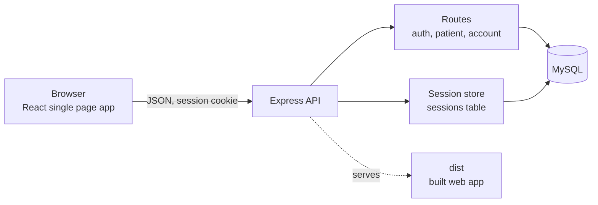
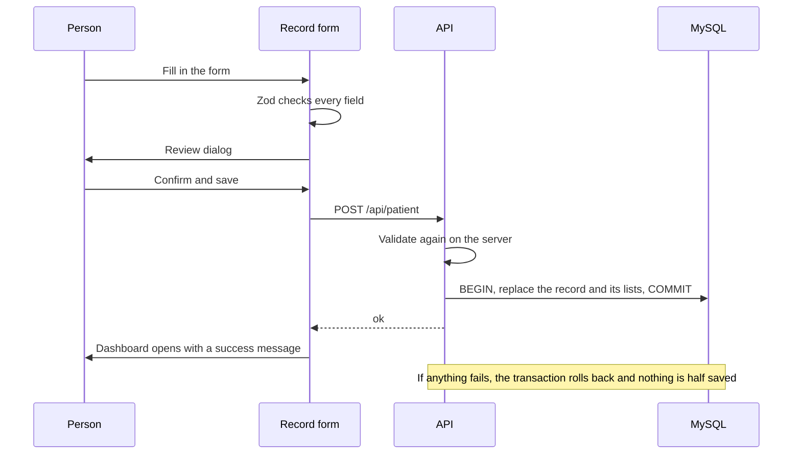

# Architecture

## Overview

In development, Vite serves the web app and forwards `/api` to Express, so the browser still sees one address and the session cookie stays first party. `npm run dev` starts both in one terminal. In production, Express serves the built files from `dist/` itself and answers any page address with the app shell, so React Router can take over.

## Saving a record

## Design decisions

| Decision | Reason |
| --- | --- |
| Session in a context (`SessionProvider`) | One place knows who is signed in, and route guards and the app shell read it |
| The session is an HTTP only cookie | No token in JavaScript storage, so a script cannot read it |
| `ProtectedRoute` remembers the page you wanted | After signing in you return there, but only to an internal path |
| Review dialog before saving | People see the whole record once more before it is stored |
| Zod rules mirror the MySQL constraints | The form catches problems before the server round trip, and both sides agree |
| The server validates again | The browser is never trusted, so the API checks every field itself |
| Radix primitives for dialogs and tabs | Focus trapping, escape to close and ARIA roles are done correctly |
| Sessions in MySQL | Logins survive restarts, and the default memory store is not meant for real hosting |
| Rate limit answers with `Retry-After` | The sign in form turns it into a countdown instead of a vague error |
| Strict Content Security Policy | Only our own scripts run. Styles allow inline attributes because Radix and the toast library set them |
| Missing files are a real 404 | A stale page asking for an old file gets an error, not HTML where it expects JavaScript |
| Age is calculated in a view | A stored age goes stale. The view always uses today's date |
| `ON DELETE CASCADE` | Deleting an account removes the whole record with one statement |

## Limits to know about

* Sensitive data is not encrypted at rest by the app
* The rate limiter is in memory, so it is per instance
* No password reset, email verification or two factor sign in yet
* The form replaces the lists on every save, so there is no history of earlier versions
